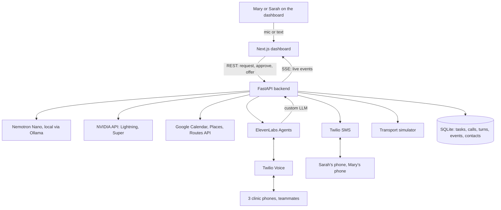

# LifeLine — Architecture and Interface Contracts

> **Status: v1 contracts, agreed 2026-11-21.** Changes go through PR with review by the affected owners. Typed schemas in `shared/` become the source of truth once they exist and match this file.

## System boundaries



**Authoritative state lives in the backend.** Adapters return observed facts. Models return suggestions that the code validates. The frontend never changes state directly.

## Directory ownership

- `backend/` (Person 1): FastAPI app, orchestrator, Nemotron wrappers, hard rules, state transitions, SQLite, event bus, SSE, approvals, LLM proxy, demo reset, metrics.
- `integrations/` (Person 2): ElevenLabs, Twilio, Google adapters and the simulators. Pure functions with typed outputs. No database writes; they return facts and the orchestrator records them.
- `frontend/` (Person 3): Next.js app. `frontend/prototype/` is the static replay demo and the visual spec for every event.
- `shared/` (review): JSON Schemas for events, task projections and adapter outputs.
- `tests/` (shared): scenario tests T1–T12.

## Nemotron usage

| Step | Model | Where | Input | Output |
|---|---|---|---|---|
| Intake | Nemotron Nano, 4-bit | Laptop, Ollama | Raw utterance, user record | `IntakeRequest` JSON, redacted |
| Contact message | Nemotron Nano, 4-bit | Laptop, Ollama | Full task record, contact scope | One SMS-length message with only the allowed facts |
| Call agent | Nemotron 3.5 Lightning | NVIDIA API via backend proxy | Per-call system prompt + conversation | Streamed replies to the receptionist |
| Rank and explain | Nemotron 3 Super | NVIDIA API | Filtered offers, free windows, distances, priority | `Decision` JSON with score, reasons, trade-off |
| Call summary | Nemotron 3 Super | NVIDIA API | Call transcript | `CallResult` JSON if the ElevenLabs data collection is missing a field |

Exact model IDs go in `.env` (`NEMOTRON_NANO_TAG`, `NEMOTRON_LIGHTNING_ID`, `NEMOTRON_SUPER_ID`). Do not invent defaults; verify at kickoff. The full rationale for the local model is in `docs/DECISIONS.md`.

## Pipeline (orchestrator.py)

Deterministic, in this order. Each step writes an event; the task status is the step name.

1. `intake` — Nano → `IntakeRequest`. Emit `request`.

   The dashboard may ask for missing budget / ride preferences in the browser and fold the answers into the utterance before `POST /api/requests`. That completes the request (D5); it does not create a task or propose clinic options. Requests that already include both preferences skip the UI. A labelled `?workspace=demo` path can run the same questions as a browser-only simulation. Any backend preference API stays on issue #86.

2. `calendar` — `calendar.free_windows()` for the requested range.
3. `places` — `places.find_clinics()` top 3, then `distance.drive()` from the owner's home. Emit `call_start` ×3 with distance meta.
4. `calling` — `voice.start_call()` ×3 in parallel. Transcript lines arrive through the LLM proxy and the post-call webhook; emit `call_status`, `transcript`, `call_result`. Mock and simulator lines take the same recorder (`llm_proxy.record_turn`, one `turns` row and one `transcript` event per `(call_id, seq)`), labelled `simulated: true`.
5. `ranking` — `ranking.hard_rules()` drops offers over budget, outside free windows, or not insured. `ranker.rank()` (Super) scores the rest. Emit `decision`. If nothing survives, status `failed` with reason, emit `task_updated`, notify both, stop.
6. `awaiting_approval` — SMS the owner the pick. Emit `approval_required`. Wait for `POST /api/tasks/{id}/approve` or SMS `YES`. Timeout: one reminder, then stay waiting.
7. `booking` — `voice.confirm_booking()` (a short call-back, or the mock) returns `Confirmation`. Only on `confirmed`: `calendar.create_event()` once, keyed by task id. Emit `booked`. On `tentative`: emit `booked` with `tentative: true` and no calendar event.
8. `transport` — `transport.check()` → `TransportOptions`. Emit `transport_check`. If available (never in the demo fixture): skip to 10.
9. `awaiting_contact` — Nano writes the scoped message; `sms.send()` to the contact. Emit `contact_request`. Wait for `POST /api/webhooks/twilio/sms` from the allowlisted number or `POST /api/contacts/offers`. Emit `contact_reply`, then `ride_confirmed` or keep waiting.
10. `completed` — final SMS to owner and contact. Emit `notified`, `task_updated`.

## Data model (SQLite)

`tasks`: `{id, owner_id, status, intake_json, windows_json, decision_json, booking_json, transport_json, created_at, updated_at}`
`contacts`: `{id, owner_id, name, phone_e164, relationship, scope}` — scope is `ride_requests` for the MVP.
`calls`: `{id, task_id, clinic_name, clinic_phone, distance_mi, status, result_json, external_ref, started_at, ended_at}` — `external_ref` is the ElevenLabs conversation id.
`turns`: `{id, call_id, seq, speaker, text, at}` — speaker is `agent` or `clinic`. Text only.
`events`: `{id, task_id, type, payload_json, visibility, at}` — visibility `owner`, `contact` or `internal`.
`receipts`: `{id, task_id, step, kind, external_id, payload_json, at}` — unique on `(task_id, step)`. One row per external side effect (`sms:<step>`, `booking:confirm`, `calendar`; `external_id` is the message id, confirmation ref or calendar event id) and per idempotent reply (`reply:<route>:<key>` for approve and contact offers, `request:<key>` for `POST /api/requests`). `payload_json` is what the effect returned and is replayed to a retry.

Task statuses: `intake`, `calendar`, `places`, `calling`, `ranking`, `awaiting_approval`, `booking`, `transport`, `awaiting_contact`, `completed`, `failed`, `cancelled`.

Every external side effect (SMS, booking, calendar insert) is keyed by `task_id` plus step name and is skipped if a receipt already exists (`app/receipts.py`, `once()`): the row is written right after the effect succeeds, a failed effect leaves none, and two concurrent attempts race on the unique index so one receipt survives and both callers get it. Receipts persist across restarts, so a retried `POST` after a restart gets the same reply.

`POST /api/demo/reset` (development only) cancels every running pipeline, wipes all six tables, reseeds the contacts from `backend/fixtures/users.json` and two finished runs from `backend/fixtures/past_runs.json` for the history page, then tells every open `GET /api/live` stream to start over with a fresh `snapshot` (event ids restart after a wipe, so a cursor from before the reset is meaningless).

## REST interface (v1)

| Method | Endpoint | Body | Result |
|---|---|---|---|
| `POST` | `/api/requests` | `{owner_id, actor_id, text?, audio_b64?, idempotency_key}` | `201 {task_id}`; starts the pipeline |
| `GET` | `/api/tasks` | `?owner_id&limit` | history, newest first, viewer-scoped |
| `GET` | `/api/tasks/{id}` | — | task projection for the viewer role |
| `GET` | `/api/tasks/{id}/events` | — | ordered events filtered by viewer visibility |
| `POST` | `/api/tasks/{id}/approve` | `{actor_id, decision: "approve" or "reject", idempotency_key}` | owner only |
| `POST` | `/api/contacts/offers` | `{task_id, contact_id, offer: {can_drive, pickup_time?}, idempotency_key}` | contact's dashboard reply |
| `GET` | `/api/live` | `?viewer_id` | **SSE**: `snapshot` then events; viewer-scoped |
| `GET` | `/api/session` | — | sets the `lifeline_session` cookie; the dashboard calls it once before any read |
| `POST` | `/v1/chat/completions` | OpenAI chat format from ElevenLabs | custom LLM proxy to Lightning; streams; logs turns |
| `POST` | `/api/webhooks/elevenlabs/post-call` | ElevenLabs payload | transcript + data collection → `call_result` |
| `POST` | `/api/webhooks/twilio/sms` | Twilio form | signature check, allowlist, match `YES` or contact reply to the open task |
| `POST` | `/api/demo/reset` | — | `APP_ENV=development` only (403 otherwise); stops pipelines, clears every table, reseeds contacts and two past runs; returns `{stopped, cleared, seeded}` |
| `GET` | `/api/health` | — | adapter modes and versions, no secrets |

Auth for the hackathon: one shared dashboard session cookie, `viewer_id` chosen on a role picker. Not production identity. `GET /api/session` issues `lifeline_session`, an HMAC-signed token under `DASHBOARD_SESSION_SECRET` (HttpOnly, SameSite=Lax); `GET /api/live` and `GET /api/tasks/{id}/events` answer 401 without a valid one. In development with no secret set the app signs with a random per-process secret.

## Live events (SSE) — the dashboard contract

The prototype `frontend/prototype/index.html` renders the first eight exactly as listed. The Next.js app renders all of them.

```text
{ type: "request", text, chips: [..] }                       // chip starting with "!" renders green
{ type: "call_start", call_id, clinic, meta }                // meta: "1.2 mi · 6 min"
{ type: "call_status", call_id, status: "dialing"|"live"|"hold"|"done" }
{ type: "transcript", call_id, seq, speaker: "agent"|"clinic", text }   // seq: 1-based position in the call; mock lines carry simulated: true
{ type: "call_result", call_id, price, slot, insured, slotOk }
{ type: "decision", winner, title, reasons: [..], second: [..], tradeoff }
{ type: "booked", calendar, sms_user, tentative? }
{ type: "notified", sms_contact, sms_user? }
{ type: "approval_required", pick: {clinic, slot, price}, expires_at }
{ type: "approved", by, via: "dashboard"|"sms" }
{ type: "transport_check", status: "checking"|"unavailable"|"available", reason, simulated: true }
{ type: "contact_request", contact, message }
{ type: "contact_reply", contact, text, offer }
{ type: "ride_confirmed", driver, pickup_time }
{ type: "task_updated", status, reason?, message? }                    // reason: error code or note code; message: plain words for the dashboard
{ type: "snapshot", task, calls, events }                    // first message on every (re)connect
{ type: "heartbeat" }                                        // every 15 s
```

SSE details: `id:` is the events-table id and increases per owner; the `snapshot` carries the id of the last event it contains; the client ignores ids already applied. Headers `Cache-Control: no-cache, no-transform, no-transform`, `X-Accel-Buffering: no`. `LIVE_STREAM_MODE=poll` makes the dashboard poll `GET /api/tasks/{id}/events` once a second instead.

**Visibility:** an event's `visibility` is `owner` (the owner only), `contact` (both roles) or `internal` (no dashboard). A viewer whose id is a row in `contacts` is that owner's contact; any other viewer id is an owner and sees its own tasks. `request.text` and the raw intake are `owner` only: the `request` event is emitted with `contact` visibility and the backend strips `text` for the contact viewer, so the contact view receives `request` with chips but no text. `transcript` events are visible to both roles because the agent only ever speaks redacted facts. `contact_request` and `contact_reply` are visible to both.

## Adapter contracts (integrations/)

```python
# nemotron (backend/app/nemotron/)
local_intake.redact(utterance: str, user: UserRecord) -> IntakeRequest
local_intake.contact_message(owner: UserRecord, intake: IntakeRequest, facts: ContactFacts, *, relationship, request_text, template, model) -> ContactMessage  # on device; text checked, template fallback
ranker.rank(offers: list[Offer], windows: list[Window], priority: str) -> Decision

# integrations/
calendar.free_windows(owner_id, start_iso, end_iso) -> list[Window]
calendar.create_event(owner_id, booking: Booking, idempotency_key) -> CalendarReceipt
places.find_clinics(care_type, area, limit=3) -> list[Clinic]          # name, phone_e164, address, lat, lng, place_id
distance.drive(origin, clinics) -> list[Distance]                      # miles, minutes
voice.start_call(call: CallSpec) -> CallHandle                         # ElevenLabs outbound via Twilio; CallSpec has clinic, redacted request, windows, call_id
voice.confirm_booking(call: CallSpec, slot) -> Confirmation            # status: confirmed | tentative | rejected
sms.send(to_e164, text, idempotency_key) -> MessageReceipt
sms.parse_inbound(form) -> InboundSms                                  # verified sender, body, correlation
transport.check(booking: Booking, needs: dict) -> TransportOptions     # fixture: available=False, reason UNAVAILABLE_ACCESSIBLE_RIDE
```

`IntakeRequest`: `{care_type, budget_max, insurance_carrier, time_range, needs_ride, search_area, dropped_fields: [..]}` — `dropped_fields` names what was removed, for the metrics, never the values.
`Offer`: `{call_id, clinic, price, slot_start, slot_end, insured, distance_mi, drive_min}`.
`Decision`: `{winner_call_id, score, reasons: [..], second: [..], tradeoff, ranked: [{call_id, score}]}`.
`Confirmation`: `{status, confirmation_ref, evidence: "clinic said ..." }`.

## ElevenLabs custom-LLM proxy

ElevenLabs calls `POST /v1/chat/completions` on the tunnel URL with the conversation so far. The proxy: checks `elevenlabs_extra_body.proxy_secret` against `LLM_PROXY_SECRET`, reads `call_id` from the same `elevenlabs_extra_body` (set per call as `custom_llm_extra_body` at call start; dynamic variables do not reach the proxy, they come back in the post-call webhook), builds the system prompt from `prompts.call_agent(call_spec)`, forwards to the NVIDIA API with `NEMOTRON_LIGHTNING_ID` and `stream: true`, relays the stream back, and writes each completed agent and clinic turn to `turns` while emitting `transcript` events. The post-call webhook supplies the final transcript and the data-collection fields (`price`, `slot`, `insured`); if any is missing, Super extracts it from the transcript. The webhook is verified with `ELEVENLABS_WEBHOOK_SECRET` (`ElevenLabs-Signature` header) before anything is read. Verified field names: [`docs/ELEVENLABS.md`](ELEVENLABS.md).

## Invariants

1. The raw utterance is never sent to any network endpoint. Only `IntakeRequest` leaves the device.
2. No booking and no calendar write before an `approved` event for that task.
3. A calendar event is created only after a `confirmed` Confirmation, exactly once.
4. Status and the dashboard chips come from structured results and receipts, never from transcript text.
5. The contact receives only the fields in their scope; the contact view never receives `owner`-visibility events.
6. Inbound SMS is acted on only from allowlisted numbers and only while a matching task is waiting.
7. Repeated webhooks and retries create no duplicate side effects.
8. Every adapter has a mock mode that emits the same events, labelled `simulated: true` where it matters.
9. Transcripts are text only. No audio is stored.

## Environment variables (`.env.example`)

```bash
APP_ENV=development
APP_TIMEZONE=America/Chicago
DATABASE_URL=sqlite:///./lifeline.db
PUBLIC_BASE_URL=            # ngrok https URL for webhooks and the LLM proxy
LLM_PROXY_SECRET=           # shared with the ElevenLabs agent config
DASHBOARD_SESSION_SECRET=   # signs the lifeline_session cookie; random per process in development when empty
NVIDIA_API_KEY=
NEMOTRON_LIGHTNING_ID=      # verify on build.nvidia.com
NEMOTRON_SUPER_ID=
OLLAMA_BASE_URL=http://localhost:11434
NEMOTRON_NANO_TAG=          # 4-bit tag pulled into Ollama
ELEVENLABS_API_KEY=
ELEVENLABS_AGENT_ID=
ELEVENLABS_PHONE_NUMBER_ID= # imported Twilio number
ELEVENLABS_WEBHOOK_SECRET=  # verifies ElevenLabs-Signature on the post-call webhook
TWILIO_ACCOUNT_SID=
TWILIO_AUTH_TOKEN=
TWILIO_PHONE_NUMBER=
GOOGLE_CLIENT_ID=
GOOGLE_CLIENT_SECRET=
GOOGLE_REFRESH_TOKEN=       # one test account
GOOGLE_MAPS_API_KEY=        # Places + Routes API
DEMO_PHONE_ALLOWLIST=       # comma-separated teammate numbers, E.164
VOICE_MODE=mock             # mock | live
PLACES_MODE=fixture         # fixture | live
CALENDAR_MODE=mock          # mock | live
SMS_MODE=mock               # mock | live
TRANSPORT_MODE=fixture
LIVE_STREAM_MODE=sse        # sse | poll
```

## Error codes

`INTAKE_INCOMPLETE`, `NO_CLINICS_FOUND`, `CALL_FAILED`, `NO_ELIGIBLE_OFFER`, `RANKING_FAILED`, `APPROVAL_TIMEOUT`, `BOOKING_TENTATIVE`, `BOOKING_REJECTED`, `CALENDAR_ERROR`, `TRANSPORT_UNAVAILABLE`, `CONTACT_DECLINED`, `REJECTED_BY_OWNER`, `SMS_NOT_SENT`, `UNVERIFIED_SENDER`, `WEBHOOK_DUPLICATE`, `INTERNAL_ERROR`. Each produces an event and either a retry, a wait state or `failed`. Never a silent `completed`.

## Integration checkpoints

1. Mock everything → full event sequence on `GET /api/live` → dashboard renders it.
2. Nano intake on the 20-utterance set → accuracy and latency logged.
3. One real outbound call to a teammate, Lightning answering through the proxy → transcript and `call_result`.
4. Three concurrent calls.
5. Real Calendar insert once; real Places and Routes API.
6. SMS round trip through the tunnel: approval YES and contact reply.
7. Two full runs with reset between them.
