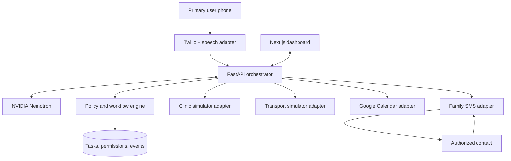

# LifeLine — Implementation Architecture and Interface Contracts

> **Status: proposed v0 contracts**. All owners should approve before implementation. Code/typed schemas become source of truth only after they are introduced and synced with these docs.

## System boundaries



**Authoritative business state lives in the FastAPI workflow engine.** Integrations return observed results; frontend never directly transitions task status. Model outputs are untrusted suggestions until schema, policy, and tool checks pass.

## Directory ownership and boundaries

- `backend/` (Person 1): API, Nemotron wrapper, planning/tool loop, task state machine, policies, persistence and events.
- `integrations/` (Person 2): tools/adapters for clinic, transportation, Twilio SMS/voice, speech and Google Calendar; pure typed outputs; no direct DB status mutation.
- `frontend/` (Person 3): read-only dashboard plus approval/offer requests through API; no direct integration credentials.
- `shared/` (review all affected owners): OpenAPI/spec types and schemas.
- `tests/` (collaborative): cross-system scenario tests.

## Core state model

Task statuses: `pending`, `running`, `waiting_for_user_approval`, `waiting_for_family`, `waiting_for_external`, `completed`, `failed`, `cancelled`.

Subtask statuses: `pending`, `running`, `tentative`, `confirmed`, `blocked`, `failed`, `cancelled`.

**Appointment `confirmed` is evidence-based; `completed` refers to the overall goal with all required subtask dependencies satisfied.** A `running` task with one confirmed appointment and one unresolved ride is not `completed`.

### Shared JSON response example

```json
{
  "id": "task_demo_001",
  "owner_id": "demo_user_001",
  "goal": "Attend eye appointment and arrange a ride",
  "status": "waiting_for_family",
  "timezone": "America/Chicago",
  "constraints": {
    "excluded_weekdays": ["tuesday"],
    "preferred_time_of_day": "morning",
    "accessible_transport_required": true
  },
  "subtasks": [
    {"id": "appt", "kind": "appointment", "status": "confirmed", "depends_on": [], "evidence_id": "ev_clinic_001"},
    {"id": "ride", "kind": "transportation", "status": "blocked", "depends_on": ["appt"], "evidence_id": "ev_transport_001"}
  ],
  "created_at": "2026-11-21T12:00:00-06:00",
  "updated_at": "2026-11-21T12:00:30-06:00"
}
```

Dates/times in examples are **fictional fixtures**, not actual bookings. Persist ISO 8601 timestamps with offsets, and normalize for calendar integrations.

### Event envelope

```json
{
  "id": "event_001",
  "task_id": "task_demo_001",
  "type": "transport.unavailable",
  "source": "transport_adapter",
  "timestamp": "2026-11-21T12:00:30-06:00",
  "payload": {"reason_code": "UNAVAILABLE_ACCESSIBLE_RIDE"},
  "visibility": "owner_only",
  "correlation_id": "run_001"
}
```

Valid visibility: `owner_only`, `family_transport`, `system_internal`. Never send a raw internal event to family without allowlisted projection fields.

## Proposed REST interface (v0)

| Method | Endpoint | Request | Result / notes |
|---|---|---|---|
| `POST` | `/api/tasks` | `{owner_id, utterance, channel, idempotency_key}` | `201 {task_id,status}`; demo auth only |
| `GET` | `/api/tasks/{id}` | — | task projection scoped to authorized viewer |
| `GET` | `/api/tasks/{id}/events` | — | ordered, privacy-filtered events; polling OK |
| `POST` | `/api/tasks/{id}/approve` | `{actor_id, decision, action_id, idempotency_key}` | validated approval or rejection |
| `POST` | `/api/tasks/{id}/cancel` | `{actor_id, reason}` | cancels only cancellable steps |
| `POST` | `/api/family/offers` | `{task_id,contact_id,offer,request_id}` | records offer; **does not auto-confirm transport** |
| `POST` | `/api/webhooks/twilio/sms` | Twilio webhook | validate signature, sender allowlist and correlation token |
| `POST` | `/api/webhooks/twilio/voice` | Twilio webhook | inbound call bridge/voice route |
| `GET` | `/api/health` | — | adapter readiness and version, no secrets |

Use service auth internally; no unauthenticated public dashboard. A hackathon demo may use a single allowlisted account/session but must not present that as production identity management.

## Integration tool contracts

**All adapter calls use structured, validated input/output.** Example Python-oriented signatures:

```python
calendar.find_free_slots(owner_id: str, start_iso: str, end_iso: str, duration_min: int) -> list[Slot]
clinic.search_slots(provider_id: str, constraints: Constraints) -> list[Slot]
clinic.confirm_slot(provider_id: str, slot_id: str, confirmation_key: str) -> Confirmation
transport.check_options(appointment: ConfirmedAppointment, requirements: dict) -> TransportOptions
family.send_assistance_request(task_id: str, contact_id: str, scoped_message: str, idempotency_key: str) -> MessageReceipt
family.record_offer(task_id: str, contact_id: str, offer: dict) -> OfferReceipt
calendar.create_event(owner_id: str, confirmed_appointment: dict, idempotency_key: str) -> CalendarReceipt
```

`Slot`: `{slot_id,start_at,end_at,location_id,provider_id,status}`; `status` is `offered` until provider explicitly confirms.

`Confirmation`: `{confirmation_id,slot_id,confirmed_at,source,evidence_ref,status}`; `status` is `confirmed` or `tentative` or `rejected`. The backend checks this before calendar creation.

`TransportOptions`: `{available,reason_code,options}`. Use explicit travel-time fixture data; do not let the LLM fabricate transit durations.

`MessageReceipt`: `{message_id,delivery_status,correlation_token}`; delivered SMS is not an affirmative family response.

## Core agent decision schema

Nemotron returns **one next-step proposal per cycle**, with model-facing tool definitions validated by the backend:

```json
{
  "intent": "schedule_appointment_with_transport",
  "next_action": "request_family_assistance",
  "tool_name": "family.send_assistance_request",
  "arguments": {"task_id": "task_demo_001", "contact_id": "family_001"},
  "reason_summary": "Accessible transport is unavailable; authorized family assistance is permitted.",
  "needs_user_approval": false
}
```

Only emit `reason_summary` as a concise **decision explanation**, not private chain-of-thought. Backend validates tool name, JSON schema, task state, recipient permission, side-effect idempotency, and any required approval before action. Cap iterations/retries and fall back to a human-readable blocked status.

## State machine and workflow invariants

1. Created → `pending` → `running`.
2. Clinic provides offered slot → appointment `tentative`; do not create final event.
3. Provider verifies slot → appointment `confirmed`; create calendar event once (use idempotency key).
4. Transport unavailable → transport `blocked`; task `waiting_for_family` only if consented contact exists; otherwise ask user.
5. Verified family response creates an `offered` ride; must check timing, permissions and requested primary-user approval before `confirmed`.
6. Overall `completed` only if all required dependent subtasks are confirmed and no mandatory approval is outstanding.
7. On appointment change, invalidate transport compatibility and revalidate before completion.
8. On revoked access, block future family notifications and writes immediately.
9. A repeated webhook, model retry or page refresh may not create duplicate external side effects.
10. Secrets, clinical details, raw transcripts and unrelated appointment contents are never included in family projections by default.

## Family permission policy (MVP)

Pre-enroll **one synthetic, verified contact** and one permission: `share_transport_assistance`. Backend allows only a minimal message (appointment day/time if consented, transport need, response instructions). Every incoming SMS must match a verified sender and unexpired task-specific token. Do not treat the claimed sender name or unverified SMS body as proof of authority; provider signature and sender checks protect a demo but are not sufficient for production authentication. Consent can be revoked.

Stretch: role-based scopes for update-only, offer-help and delegated approval, per-task grants, consent UI, audit trail, explicit expiration.

## Integration modes and configuration

Suggested environment variables (names are proposed, implementation may adapt):

```bash
APP_ENV=development
APP_TIMEZONE=America/Chicago
NEMOTRON_MODEL= # exact available model ID; no invented default
NVIDIA_API_KEY=
TWILIO_ACCOUNT_SID=
TWILIO_AUTH_TOKEN=
TWILIO_PHONE_NUMBER=
ELEVENLABS_API_KEY=
GOOGLE_CLIENT_ID=
GOOGLE_CLIENT_SECRET=
GOOGLE_REFRESH_TOKEN= # for one test account, if auth flow supports it
DATABASE_URL=sqlite:///./lifeline.db
CLINIC_MODE=mock
TRANSPORT_MODE=mock
CALENDAR_MODE=mock
VOICE_MODE=mock
SMS_MODE=mock
DEMO_CONTACT_ALLOWLIST= # number(s) owned by consenting teammates
PUBLIC_WEBHOOK_BASE_URL= # verified HTTPS tunnel URL
```

Secrets must live in ignored `.env`, secret manager or CI secret store, never in the repository, logs, browser code, or agent messages. Webhooks require HTTPS and Twilio signature validation when enabled. Verify live provider SDK APIs during implementation rather than assuming identical interfaces.

## Error contracts and recovery

Use stable error codes such as `CONSTRAINT_CONFLICT`, `UNVERIFIED_PROVIDER_CONFIRMATION`, `UNAUTHORIZED_FAMILY_ACCESS`, `TRANSPORT_UNAVAILABLE`, `CALENDAR_ERROR`, `WEBHOOK_DUPLICATE`, `VOICE_DISCONNECTED`. Each failure generates an event and either a safe retry, user clarification, or unresolved state; do not silently move to `completed`.

## Integration checkpoints

1. Seed task + GET endpoints → frontend displays state.
2. Nemotron tool calls into mock clinic and transport → events appear.
3. Authenticated, correlation-bound family reply → updates task.
4. Calendar confirmation → one event only.
5. Twilio and speech bridges → identical backend task contract.

**Contract changes:** propose in PR, notify all affected owners via team chat/board, update this file and tests together. No unilateral breaking changes.
