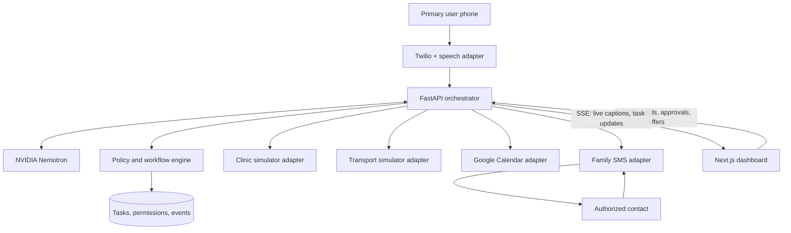

# LifeLine — Implementation Architecture and Interface Contracts

> **Status: proposed v0 contracts**. All owners should approve before implementation. Code/typed schemas become source of truth only after they are introduced and synced with these docs.

## System boundaries



**Authoritative business state lives in the FastAPI workflow engine.** Integrations return observed results; frontend never directly transitions task status. Model outputs are untrusted suggestions until schema, policy, and tool checks pass.

## Directory ownership and boundaries

- `backend/` (Person 1): API, Nemotron wrapper, planning/tool loop, task state machine, policies, persistence and events; call/turn sessions, the live SSE stream and history endpoints.
- `integrations/` (Person 2): tools/adapters for clinic, transportation, Twilio SMS/voice, speech and Google Calendar; pure typed outputs; no direct DB status mutation. Feeds finalized speech-to-text into the conversation contract and speaks reply chunks via TTS; never writes turns or call status directly.
- `frontend/` (Person 3): read-only dashboard plus approval/offer requests through API; live call panel and history pages; no direct integration credentials.
- `shared/` (review all affected owners): OpenAPI/spec types and schemas.
- `tests/` (collaborative): cross-system scenario tests.

## Core state model

Task statuses: `pending`, `running`, `waiting_for_user_approval`, `waiting_for_family`, `waiting_for_external`, `completed`, `failed`, `cancelled`.

Subtask statuses: `pending`, `running`, `tentative`, `confirmed`, `blocked`, `failed`, `cancelled`.

**Appointment `confirmed` is evidence-based; `completed` refers to the overall goal with all required subtask dependencies satisfied.** A `running` task with one confirmed appointment and one unresolved ride is not `completed`.

### Shared JSON response example

```json
{
  "id": "task_demo_001",
  "owner_id": "demo_user_001",
  "goal": "Attend eye appointment and arrange a ride",
  "status": "waiting_for_family",
  "timezone": "America/Chicago",
  "constraints": {
    "excluded_weekdays": ["tuesday"],
    "preferred_time_of_day": "morning",
    "accessible_transport_required": true
  },
  "subtasks": [
    {"id": "appt", "kind": "appointment", "status": "confirmed", "depends_on": [], "evidence_id": "ev_clinic_001"},
    {"id": "ride", "kind": "transportation", "status": "blocked", "depends_on": ["appt"], "evidence_id": "ev_transport_001"}
  ],
  "created_at": "2026-11-21T12:00:00-06:00",
  "updated_at": "2026-11-21T12:00:30-06:00"
}
```

Dates/times in examples are **fictional fixtures**, not actual bookings. Persist ISO 8601 timestamps with offsets, and normalize for calendar integrations.

### Event envelope

```json
{
  "id": "event_001",
  "task_id": "task_demo_001",
  "type": "transport.unavailable",
  "source": "transport_adapter",
  "timestamp": "2026-11-21T12:00:30-06:00",
  "payload": {"reason_code": "UNAVAILABLE_ACCESSIBLE_RIDE"},
  "visibility": "owner_only",
  "correlation_id": "run_001"
}
```

Valid visibility: `owner_only`, `family_transport`, `system_internal`. Never send a raw internal event to family without allowlisted projection fields.

## Proposed REST interface (v0)

| Method | Endpoint | Request | Result / notes |
|---|---|---|---|
| `POST` | `/api/tasks` | `{owner_id, utterance, channel, idempotency_key}` | `201 {task_id,status}`; demo auth only |
| `GET` | `/api/tasks/{id}` | — | task projection scoped to authorized viewer |
| `GET` | `/api/tasks/{id}/events` | — | ordered, privacy-filtered events; polling OK |
| `POST` | `/api/tasks/{id}/approve` | `{actor_id, decision, action_id, idempotency_key}` | validated approval or rejection |
| `POST` | `/api/tasks/{id}/cancel` | `{actor_id, reason}` | cancels only cancellable steps |
| `POST` | `/api/family/offers` | `{task_id,contact_id,offer,request_id}` | records offer; **does not auto-confirm transport** |
| `POST` | `/api/webhooks/twilio/sms` | Twilio webhook | validate signature, sender allowlist and correlation token |
| `POST` | `/api/webhooks/twilio/voice` | Twilio webhook | inbound call bridge/voice route |
| `GET` | `/api/health` | — | adapter readiness and version, no secrets |
| `GET` | `/api/tasks` | `?owner_id&status&limit&before` | task history, newest first, viewer-scoped |
| `POST` | `/api/calls` | `{owner_id, channel, idempotency_key}` | starts a web-text/web-voice session (phone calls start from the voice webhook); `201 {call_id}` |
| `POST` | `/api/calls/{id}/turns` | `{text, idempotency_key}` | caller turn for web channels; `202`; reply arrives on the live stream |
| `GET` | `/api/calls` | `?owner_id&limit&before` | call history, newest first (see *Live call streaming and history*) |
| `GET` | `/api/calls/{id}` | — | call + finalized turns + linked task ids; owner-scoped |
| `GET` | `/api/owners/{owner_id}/live` | — | **Server-Sent Events** stream: snapshot, then call/turn/task events; owner-scoped |
| `POST` | `/api/demo/reset` | — | **only when `APP_ENV=development`**: clears tasks, calls, turns, events; reseeds fixtures |

Use service auth internally; no unauthenticated public dashboard. A hackathon demo may use a single allowlisted account/session but must not present that as production identity management.

## Integration tool contracts

**All adapter calls use structured, validated input/output.** Example Python-oriented signatures:

```python
calendar.find_free_slots(owner_id: str, start_iso: str, end_iso: str, duration_min: int) -> list[Slot]
clinic.search_slots(provider_id: str, constraints: Constraints) -> list[Slot]
clinic.confirm_slot(provider_id: str, slot_id: str, confirmation_key: str) -> Confirmation
transport.check_options(appointment: ConfirmedAppointment, requirements: dict) -> TransportOptions
family.send_assistance_request(task_id: str, contact_id: str, scoped_message: str, idempotency_key: str) -> MessageReceipt
family.record_offer(task_id: str, contact_id: str, offer: dict) -> OfferReceipt
calendar.create_event(owner_id: str, confirmed_appointment: dict, idempotency_key: str) -> CalendarReceipt
```

`Slot`: `{slot_id,start_at,end_at,location_id,provider_id,status}`; `status` is `offered` until provider explicitly confirms.

`Confirmation`: `{confirmation_id,slot_id,confirmed_at,source,evidence_ref,status}`; `status` is `confirmed` or `tentative` or `rejected`. The backend checks this before calendar creation.

`TransportOptions`: `{available,reason_code,options}`. Use explicit travel-time fixture data; do not let the LLM fabricate transit durations.

`MessageReceipt`: `{message_id,delivery_status,correlation_token}`; delivered SMS is not an affirmative family response.

## Core agent decision schema

Nemotron returns **one next-step proposal per cycle**, with model-facing tool definitions validated by the backend:

```json
{
  "intent": "schedule_appointment_with_transport",
  "next_action": "request_family_assistance",
  "tool_name": "family.send_assistance_request",
  "arguments": {"task_id": "task_demo_001", "contact_id": "family_001"},
  "reason_summary": "Accessible transport is unavailable; authorized family assistance is permitted.",
  "needs_user_approval": false
}
```

Only emit `reason_summary` as a concise **decision explanation**, not private chain-of-thought. Backend validates tool name, JSON schema, task state, recipient permission, side-effect idempotency, and any required approval before action. Cap iterations/retries and fall back to a human-readable blocked status.

## Live call streaming and history (v0 proposal)

**Goal:** during a live call, the dashboard shows LifeLine's reply as it is generated, like live captions, along with the caller's finalized words. After the call ends, the conversation, its linked task and its event trail stay available in a history view. The web-text fallback uses the same path, so this works in the demo even without Twilio.

### What is streamed, and what is not

| Streamed | Never streamed |
|---|---|
| Agent reply text, as token deltas while Nemotron generates it | Decision JSON / tool proposals (validated whole before any action) |
| Caller speech, as **finalized** STT text per turn | Interim STT guesses, raw audio |
| Call lifecycle and task status changes | Chain-of-thought, secrets, anything above the viewer's visibility |

The tool loop now has two kinds of model call:

1. **Decide** (not streamed): the decision schema above. It must be complete JSON so it can be validated, so it is never streamed. The loop repeats Decide → validate → tool until the agent needs to speak.
2. **Reply** (streamed): once per spoken response, Nemotron writes what LifeLine says to the caller. The prompt gets only the **validated task projection** and the latest tool results. Each chunk goes to TTS and to the dashboard at the same time.

**Streamed text is conversation, not evidence.** The dashboard's status chips come only from task and subtask state, never from caption text. If the projection says `tentative`, the reply must say tentative (see T7). If the chosen Nemotron endpoint does not support streaming (check `stream: true` at kickoff), the backend sends the full reply as a single `turn.delta`. The contract stays the same.

### Data model

`Call`: `{id, owner_id, channel, status, task_ids, started_at, ended_at, summary}`
- `channel`: `phone`, `web_text`, `web_voice`
- `status`: `active`, `ended`, `dropped`
- `summary`: written at call end from task state (for example "Appointment confirmed Thu 10:00; ride pending family"). The backend builds it from state, not free model text, so history never overstates the result.

`Turn`: `{id, call_id, seq, speaker, text, status, started_at, ended_at, visibility}`
- `speaker`: `caller`, `agent`, `system`
- `status`: `streaming`, `final`, `interrupted`
- `visibility`: `owner_only` by default (see *Visibility* below)

```json
{"id": "turn_004", "call_id": "call_demo_001", "seq": 4, "speaker": "agent",
 "text": "I found Thursday at 10 AM with the eye clinic. I'm checking a ride now.",
 "status": "final", "started_at": "2026-11-21T12:00:12-06:00",
 "ended_at": "2026-11-21T12:00:15-06:00", "visibility": "owner_only"}
```

Persistence: each final or interrupted turn is written **once**, keyed by turn id. Deltas are **not** stored in the events table. The backend keeps the in-progress turn's accumulated text in memory and writes it as `interrupted` if the call drops or the reply stream fails. Losing a partial turn on a backend restart is acceptable for the MVP.

### Live stream endpoint

`GET /api/owners/{owner_id}/live` returns **Server-Sent Events**. Each dashboard tab opens one connection, which covers every call and task for that owner. This stream can also replace polling of task events. Polling remains as a fallback.

**Why SSE instead of WebSockets:** data only needs to flow from server to browser. SSE is plain HTTP, so it passes through Next.js rewrites and tunnels, and browsers reconnect automatically. FastAPI can serve it with `StreamingResponse` or `sse-starlette`. Dashboard actions (approvals, offers) stay on the existing REST POSTs.

```text
event: snapshot
id: 120
data: {"active_call": {...Call}, "turns": [...final turns], "partial_turn": {"turn_id": "turn_004", "text": "I found Thurs"}, "tasks": [...task projections]}

event: turn.delta
id: 121
data: {"call_id": "call_demo_001", "turn_id": "turn_004", "delta": "day at 10 AM"}

event: turn.completed
id: 122
data: {"call_id": "call_demo_001", "turn_id": "turn_004", "text": "<full final text>"}
```

Event types: `snapshot`, `call.started`, `turn.started`, `turn.delta`, `turn.completed`, `turn.interrupted`, `task.updated`, `call.ended`, `heartbeat`.

- `id` increases monotonically for each owner. The client ignores any id it has already applied.
- **MVP reconnect rule:** every (re)connect gets a fresh `snapshot` first, including the partial text of the in-progress turn, and then live events. Replaying from `Last-Event-ID` is a stretch goal.
- `turn.completed` carries the full final text. The client **replaces** the deltas it accumulated, which also fixes any dropped delta.
- Send a `heartbeat` every 15 seconds. Set `Cache-Control: no-cache` and `X-Accel-Buffering: no` so proxies and tunnels don't buffer or close the stream.
- **Auth:** the browser `EventSource` cannot set an `Authorization` header. The stream uses the dashboard's session cookie, served from the same origin through a Next.js rewrite. The backend checks that the viewer is the owner or the demo operator **before** opening the stream.
- **Fallback switch:** with `LIVE_STREAM_MODE=poll`, the dashboard polls `GET /api/calls/{id}` about once a second and shows only completed turns. The data is the same, just less granular.

### Conversation contract (integrations ↔ backend)

```python
conversation.start_call(owner_id: str, channel: Literal["phone", "web_text", "web_voice"], external_ref: str | None, idempotency_key: str) -> Call
conversation.handle_caller_turn(call_id: str, text: str, idempotency_key: str) -> AsyncIterator[str]  # yields reply text chunks
conversation.end_call(call_id: str, reason: Literal["completed", "caller_hangup", "dropped", "error"]) -> Call
conversation.interrupt_agent(call_id: str) -> None  # barge-in; stretch
```

- The backend sends **each reply chunk to two places**: the returned iterator (for TTS) and the live stream (for captions). Captions and audio therefore always come from the same text.
- Integrations may buffer chunks up to sentence boundaries before sending them to TTS. The dashboard still receives the raw deltas.
- Integrations pass **finalized** STT text only. The Twilio voice webhook calls `start_call` and `end_call`. A Twilio retry must not create a second call (use the `CallSid` as `external_ref` and idempotency key).
- The web-text fallback reaches the same functions through `POST /api/calls` and `POST /api/calls/{id}/turns`.

### History

- **Call list:** `GET /api/calls` returns `{id, channel, status, started_at, ended_at, summary, task_ids, outcome}`, newest first. `outcome` is derived from the linked tasks' status: `completed`, `waiting`, `failed` or `cancelled`.
- **Call detail:** `GET /api/calls/{id}` returns the call and its finalized turns. The dashboard merges these with `GET /api/tasks/{id}/events` into one timeline, sorted by timestamp, and shows status chips from task state.
- **Task list:** `GET /api/tasks` covers tasks created outside a call, for example by an SMS-only flow or a test.
- **Retention:** synthetic data only. **Text transcripts only; no audio recordings are stored** (see `AGENTS.md`). `POST /api/demo/reset` clears everything and reseeds fixtures, including **two synthetic past calls** so the history page is not empty in the demo. A production retention and deletion policy is out of scope.

### Visibility

Transcripts are some of the most sensitive data in the system (invariant 10). MVP rules:

- The owner and the demo-operator session see the live stream and the full history.
- Family viewers get **403** on `/api/owners/{id}/live` and `/api/calls*`. They still see only the allowlisted transport projection. All `turn.*` events are `owner_only`.
- Stretch: a separate consent-gated permission, `view_call_transcript`. It is off by default, revocable, and recorded in the audit trail.

## State machine and workflow invariants

1. Created → `pending` → `running`.
2. Clinic provides offered slot → appointment `tentative`; do not create final event.
3. Provider verifies slot → appointment `confirmed`; create calendar event once (use idempotency key).
4. Transport unavailable → transport `blocked`; task `waiting_for_family` only if consented contact exists; otherwise ask user.
5. Verified family response creates an `offered` ride; must check timing, permissions and requested primary-user approval before `confirmed`.
6. Overall `completed` only if all required dependent subtasks are confirmed and no mandatory approval is outstanding.
7. On appointment change, invalidate transport compatibility and revalidate before completion.
8. On revoked access, block future family notifications and writes immediately.
9. A repeated webhook, model retry or page refresh may not create duplicate external side effects.
10. Secrets, clinical details, raw transcripts and unrelated appointment contents are never included in family projections by default.
11. Streamed reply text never changes task or subtask state, and the dashboard never derives a status from it.
12. Each turn is persisted once, keyed by turn id. A dropped call or failed reply stream marks the partial turn `interrupted` and the call `dropped`; task state is unaffected and resumes on the next call.
13. Caption text shown on the dashboard, text sent to TTS, and the persisted turn text are the same string.

## Family permission policy (MVP)

Pre-enroll **one synthetic, verified contact** and one permission: `share_transport_assistance`. Backend allows only a minimal message (appointment day/time if consented, transport need, response instructions). Every incoming SMS must match a verified sender and unexpired task-specific token. Do not treat the claimed sender name or unverified SMS body as proof of authority; provider signature and sender checks protect a demo but are not sufficient for production authentication. Consent can be revoked.

Stretch: role-based scopes for update-only, offer-help and delegated approval, per-task grants, consent UI, audit trail, explicit expiration.

## Integration modes and configuration

Suggested environment variables (names are proposed, implementation may adapt):

```bash
APP_ENV=development
APP_TIMEZONE=America/Chicago
NEMOTRON_MODEL= # exact available model ID; no invented default
NVIDIA_API_KEY=
TWILIO_ACCOUNT_SID=
TWILIO_AUTH_TOKEN=
TWILIO_PHONE_NUMBER=
ELEVENLABS_API_KEY=
GOOGLE_CLIENT_ID=
GOOGLE_CLIENT_SECRET=
GOOGLE_REFRESH_TOKEN= # for one test account, if auth flow supports it
DATABASE_URL=sqlite:///./lifeline.db
CLINIC_MODE=mock
TRANSPORT_MODE=mock
CALENDAR_MODE=mock
VOICE_MODE=mock
SMS_MODE=mock
LIVE_STREAM_MODE=sse # sse | poll (fallback: completed turns only)
DEMO_CONTACT_ALLOWLIST= # number(s) owned by consenting teammates
PUBLIC_WEBHOOK_BASE_URL= # verified HTTPS tunnel URL
```

Secrets must live in ignored `.env`, secret manager or CI secret store, never in the repository, logs, browser code, or agent messages. Webhooks require HTTPS and Twilio signature validation when enabled. Verify live provider SDK APIs during implementation rather than assuming identical interfaces.

## Error contracts and recovery

Use stable error codes such as `CONSTRAINT_CONFLICT`, `UNVERIFIED_PROVIDER_CONFIRMATION`, `UNAUTHORIZED_FAMILY_ACCESS`, `TRANSPORT_UNAVAILABLE`, `CALENDAR_ERROR`, `WEBHOOK_DUPLICATE`, `VOICE_DISCONNECTED`, `REPLY_STREAM_FAILED`. Each failure generates an event and either a safe retry, user clarification, or unresolved state; do not silently move to `completed`. If a reply stream fails partway, the turn becomes `interrupted` and the agent speaks a fixed fallback line ("Sorry, let me say that again") before retrying once.

## Integration checkpoints

1. Seed task + GET endpoints → frontend displays state.
2. Nemotron tool calls into mock clinic and transport → events appear.
3. Authenticated, correlation-bound family reply → updates task.
4. Calendar confirmation → one event only.
5. Twilio and speech bridges → identical backend task contract.
6. Web-text call → reply deltas appear live on the dashboard; a refresh mid-reply restores the conversation from `snapshot`.
7. Completed demo run → appears in call history with summary, transcript and event trail; `POST /api/demo/reset` clears it.

**Contract changes:** propose in PR, notify all affected owners via team chat/board, update this file and tests together. No unilateral breaking changes.
